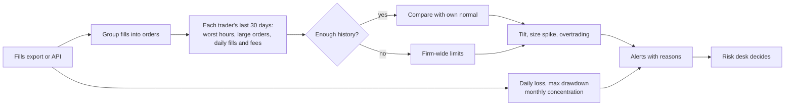

# TiltGuard


**A risk desk for crypto prop firms and copy-trading platforms: catch traders who are tilting, oversizing or churning, and breaches of firm limits, judging every trader against their own normal instead of one number for everyone.**

A prop firm funds traders and loses money when one of them blows up. A copy-trading platform loses followers' money when a leader goes on a losing streak and doubles down. Both usually watch with fixed limits ("any order over $100k"), which is noise for a large trader and blind to a small one. TiltGuard learns each trader's last 30 days and flags behaviour that is out of character:

| Alert | What it means |
|---|---|
| **Tilt** | A loss in the trader's worst 5% of hours, then opening 3x their usual 6-hour volume (revenge trading) |
| **Size spike** | An order 3x the trader's own large orders (their 95th percentile) |
| **Overtrading** | A day with 3x the usual fills, where fees ate half the result or were twice the usual on a losing day |
| **Daily loss / max drawdown** | Prop-firm limits per account |
| **Concentration** | A month whose profit came from the top 5% of trades: luck to watch, not skill to copy |

New or quiet accounts, with fewer than 20 orders of history, fall back to firm-wide limits.

## Results

`python -m tiltguard.evaluate` runs on **real Hyperliquid fills** (211,224 fills, 32 accounts). Real trades have no labels, so known episodes (tilt, size spikes, overtrading days) are injected into real accounts' streams, each scaled from that trader's previous 30 days. Noise is counted on the untouched real trades. The baseline is the usual fixed screen: orders over $100k, an hourly loss over $10k followed by $250k opened in 6 hours, more than 300 fills a day. Dev: December 2024 to February 2025. **Held-out**: March to April 2025, with subtler episodes, run once after tuning.

| dev / held-out | Injected episodes caught | Alerts per account-month on real trades |
|---|---|---|
| Global thresholds | 16/43 (37%) / 33/66 (50%) | 3.85 / 7.77 |
| **TiltGuard** | **39/43 (91%) / 61/66 (92%)** | **0.89 / 1.18** |

Held-out by type: tilt 24/25 vs 8/25, size spikes 21/21 vs 17/21, overtrading 16/20 vs 8/20.

**Reading it honestly:**
- TiltGuard catches about twice the episodes with **one seventh of the alerts** on the held-out period. A desk can read about one alert per trader per month; it cannot read eight.
- The fixed screen misses tilt almost entirely, because a $10k loss is catastrophic for one trader and a quiet hour for another.
- The misses are deliberate: TiltGuard does not call a heavy trading day overtrading when the trader ended it in profit and fees stayed small next to the result. A firm that wants those flagged sets `overtrade_fee_share` lower.
- Injected episodes are a test, not real incidents. They show the detectors find what they are built to find, at a noise level a desk can live with; the pilot measures it on the firm's own incidents.

### The original questions, answered with uncertainty

This repo began as the Primetrade.ai data science assignment: does Bitcoin market sentiment (Fear & Greed index) change how traders perform? The notebook in `notebooks/` is the original analysis. `src/tiltguard/research.py` answers it again with statistics that hold up:

| Question | Answer on this data |
|---|---|
| Do traders make more on Greed days than Fear days? | **No detectable difference.** Within each account, Greed minus Fear mean daily PnL is −$3,749 (95% CI −$16,892 to +$6,277, 31 accounts). Pooled averages differ (Fear $5,038, Greed $4,067 a day), but that gap comes from a few large accounts and wild days, not a pattern |
| Does last month's leaderboard predict next month's? | **Weakly, and unstably.** Rank correlation 0.35 (95% CI 0.20 to 0.53), swinging from 0.09 to 0.74 between months |

Both answers point the same way: sentiment and past ranking are poor guides to who to fund or copy. Behaviour is the better signal, which is why the product watches behaviour.

### How the benchmark kept me honest

| Finding | Fix |
|---|---|
| Size spikes against the trader's median order alerted 262 times in three months | Compare with the trader's own large orders (95th percentile) instead: 39 |
| Injected episodes were scaled from each account's whole history, including the future | Scale only from the 30 days before the episode |
| Some injections landed in accounts with no history, which no "own normal" can judge | Inject only where the trader is active, and add a firm-wide fallback for new accounts |
| The fallback for new accounts fired 93 times, once per fill | A quiet month falls back to the trader's whole earlier history first, and one alert per burst: 26 |
| Overtrading on fee multiples alone flagged profitable busy days (49 alerts) | Twice the usual fees counts only on a losing day: 9 |
| I ran the held-out period once with the first, untuned version (TiltGuard 41/84, fixed screen 40/84) before the fixes above | The injection changed as well, so those numbers are not comparable; the table reports the single run after tuning |

## Who buys it and how it is sold

| | |
|---|---|
| **Buyers** | Crypto prop firms (funded-trader programmes), copy-trading platforms, exchanges' and brokers' risk teams, family offices with several traders |
| **Their pain** | Funded accounts blown up by one revenge-trading afternoon; followers copying a leader whose month was one lucky trade; fixed limits that page the desk all day and still miss small accounts |
| **What they get** | A ranked alert list with the reason in plain words, per-trader history, daily-loss and drawdown checks, a monthly luck check before promoting a trader |
| **Control** | Alerts only. Pausing, de-risking or contacting a trader stays with the desk |
| **Fits in** | Exchange fill exports (CSV, Hyperliquid format or any with account, time, direction, size, PnL, fee); REST API for the platform's backend; Streamlit desk screen |

**Value example** (an illustration, not a promise): a prop firm with 500 funded accounts of $50k that loses two accounts a month to a tilt spiral loses $100k a month. Catching half of those an hour earlier, when a desk can still pause the account, is worth far more than the subscription.

| Plan (suggested) | For | Price idea |
|---|---|---|
| Starter | Up to 100 accounts | Monthly fee |
| Growth | Up to 2,000 accounts, API, custom limits | Per-account monthly fee |
| Enterprise | Exchanges, large platforms | Annual licence, on-premise, custom detectors |

**Pilot plan (one month):** load the firm's last six months of fills and its list of real incidents (blown accounts, complaints). Check how many TiltGuard would have caught, how early, and how many alerts it would have raised. Then run live next to the current limits for a month.

## How it works



## Use it

```bash
pip install -e ".[app]" && streamlit run app.py   # desk screen on the sample data, or upload your export
pip install -e .
tiltguard scan data/historical_data.csv --since 2025-03-01 --out alerts.xlsx
tiltguard research                                # Fear vs Greed and leaderboard persistence
python -m tiltguard.evaluate                      # the benchmark above
docker compose up -d                              # API :8000 + desk screen :8501
```

| Endpoint | What it does |
|---|---|
| `POST /v1/scan` | Fills (send at least 30 days per account) and optional per-account limits → alerts with reasons |
| `GET /health` | Health check |

## Limitations

- 32 accounts over about five months. The thresholds are sensible defaults, and every one is a field in `Rules` for a firm to set.
- Episodes are injected; real incidents are the test that matters, and the pilot is built around them.
- Fills are timestamped to the minute in this export, so fills of one order are grouped by account, minute, coin and direction.
- Open positions and unrealised losses are not in the export; drawdown is on realised PnL. A live feed with positions would add mark-to-market drawdown.

## Project layout

```
src/tiltguard/data.py       fills (Hyperliquid export or any similar CSV) and the Fear & Greed index
src/tiltguard/detect.py     tilt, size spikes, overtrading, limits, concentration, cold start
src/tiltguard/research.py   Fear vs Greed with a bootstrap over accounts, leaderboard persistence
src/tiltguard/evaluate.py   injected-episode benchmark vs fixed thresholds, CI gate
src/tiltguard/api.py        FastAPI service
src/tiltguard/cli.py        scan, research, benchmark
app.py                      Streamlit desk screen
notebooks/analysis.ipynb    the original assignment analysis
```
